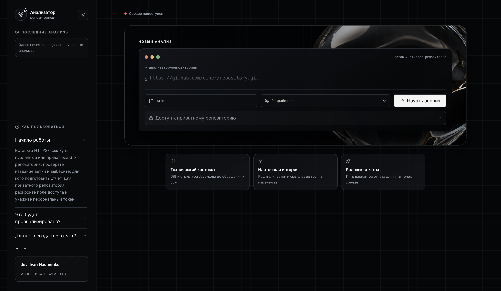
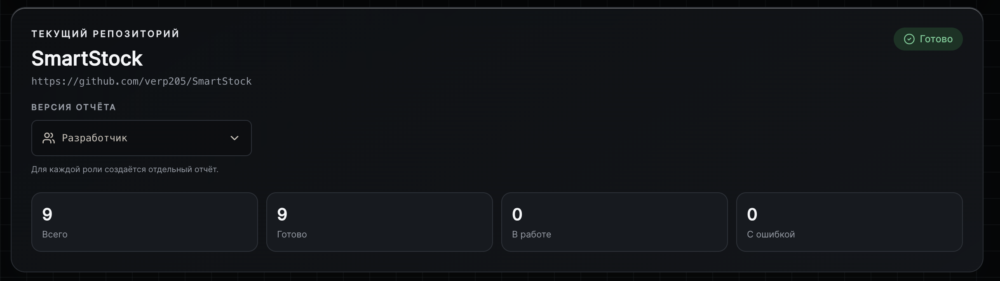
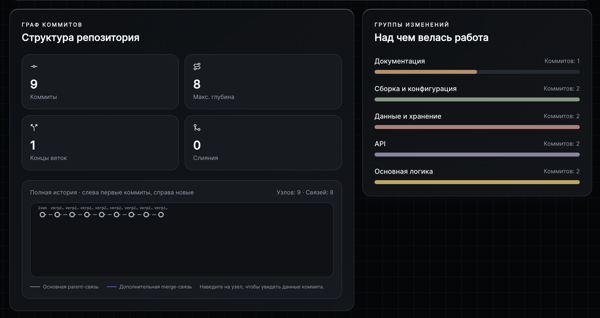
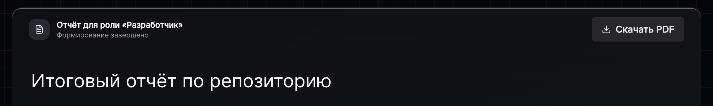

# Repository Analyzer

Многопоточный анализатор истории Java-репозиториев. Он восстанавливает граф коммитов, исследует diff и структуру Java-кода, группирует изменения и формирует цельный LLM-отчёт для выбранной роли: разработчика, аналитика, специалиста по безопасности, тимлида или руководителя.



## Что происходит во время анализа

1. JGit клонирует репозиторий или обновляет его локальную копию.
2. История коммитов сохраняется в SQLite вместе с parent-связями.
3. До 10 worker-потоков в случайном порядке извлекают diff и изменённые файлы.
4. JavaParser выделяет пакеты, классы, методы и признаки ошибок разбора.
5. Из технических данных собирается компактный контекст для LLM.
6. Ответы кэшируются по хэшу prompt, поэтому одинаковые запросы не отправляются повторно.
7. Частичные результаты поступают во frontend через SSE, а после обработки собираются в общий ролевой отчёт, который можно скачать в PDF.

Анализ идемпотентен: завершённая работа не дублируется, после перезапуска её можно продолжить, а выполнение анализа и формирование отчёта можно остановить.

## Интерфейс

### Сводка анализа

Статус репозитория, прогресс обработки и выбор отдельного отчёта для каждой роли.



### Граф и группы изменений

Точная история parent/merge-связей и смысловая группировка выполненной работы.



### Итоговый отчёт

Общая картина проекта, направления развития, архитектурная эволюция, сильные стороны, риски и рекомендации для выбранной роли.



## Быстрый запуск

Понадобятся:

- JDK 21;
- Node.js и npm;
- Ollama с моделью `qwen3:8b` либо доступ к другому OpenAI-compatible API.

По умолчанию проект использует локальную Ollama. Подготовьте модель:

```bash
ollama pull qwen3:8b
ollama serve
```

Запустите backend из корня проекта:

```bash
./mvnw spring-boot:run
```

В другом окне терминала запустите frontend:

```bash
cd frontend
npm install
npm run dev
```

Откройте [http://localhost:5173](http://localhost:5173), вставьте HTTPS-ссылку на Git-репозиторий, укажите ветку, выберите роль и нажмите **«Начать анализ»**.

Для приватного репозитория раскройте в форме блок доступа и передайте personal access token с правом чтения. Токен используется только для `clone/fetch` и не сохраняется в SQLite.

## Порты и адреса

| Компонент | Адрес | Назначение |
|---|---|---|
| Frontend | [localhost:5173](http://localhost:5173) | Пользовательский интерфейс |
| Backend API | [localhost:8080](http://localhost:8080) | REST API и SSE |
| Swagger UI | [localhost:8080/swagger-ui/index.html](http://localhost:8080/swagger-ui/index.html) | Документация API |
| Health check | [localhost:8080/actuator/health](http://localhost:8080/actuator/health) | Состояние backend |
| Ollama | `localhost:11434` | Локальный LLM API |

SQLite не использует отдельный порт. База создаётся автоматически в `data/repository-analyzer.db`, а локальные копии репозиториев — в `data/repositories`.

## Подключение другой LLM

Настройки находятся в [`src/main/resources/application.properties`](src/main/resources/application.properties). Любой OpenAI-compatible сервер подключается заменой параметров:

```properties
repository-analyzer.llm.provider=openai-compatible
repository-analyzer.llm.provider-id=my-provider
repository-analyzer.llm.base-url=https://api.example.com
repository-analyzer.llm.chat-path=/v1/chat/completions
repository-analyzer.llm.model=my-model
repository-analyzer.llm.api-key=${LLM_API_KEY:}
```

Перед запуском передайте ключ через окружение и перезапустите backend:

```bash
export LLM_API_KEY=your-api-key
./mvnw spring-boot:run
```

Для локальной Ollama ключ не нужен. Лимиты параллельных запросов, объём контекста и длина ответов также настраиваются в `application.properties`.

## Основной стек

Java 21, Spring Boot, JPA/Hibernate, SQLite, Flyway, JGit, JGraphT, JavaParser, SSE, React, TypeScript, Vite и Tailwind CSS.

---

**dev. Ivan Naumenko · 2026**
